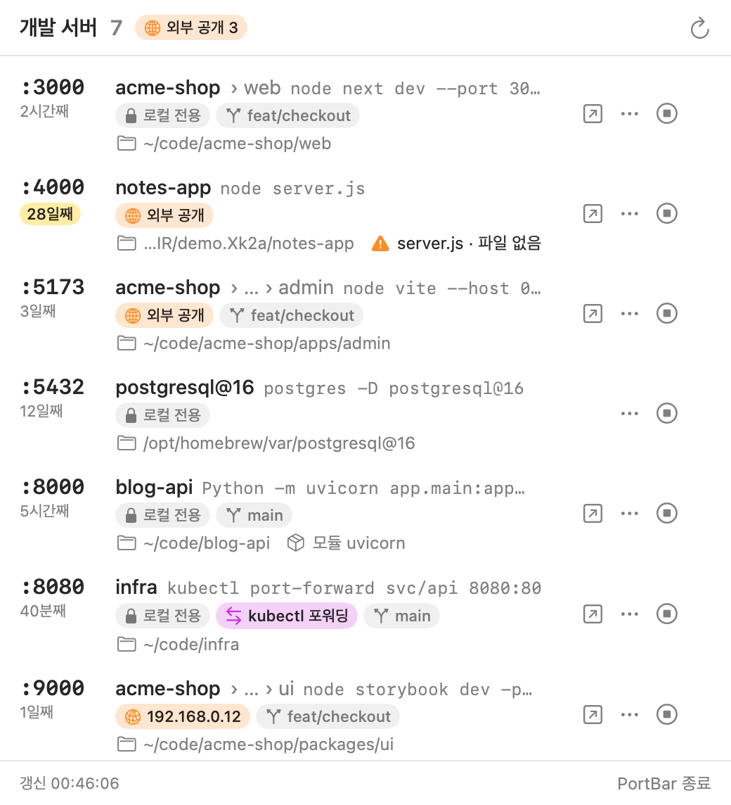
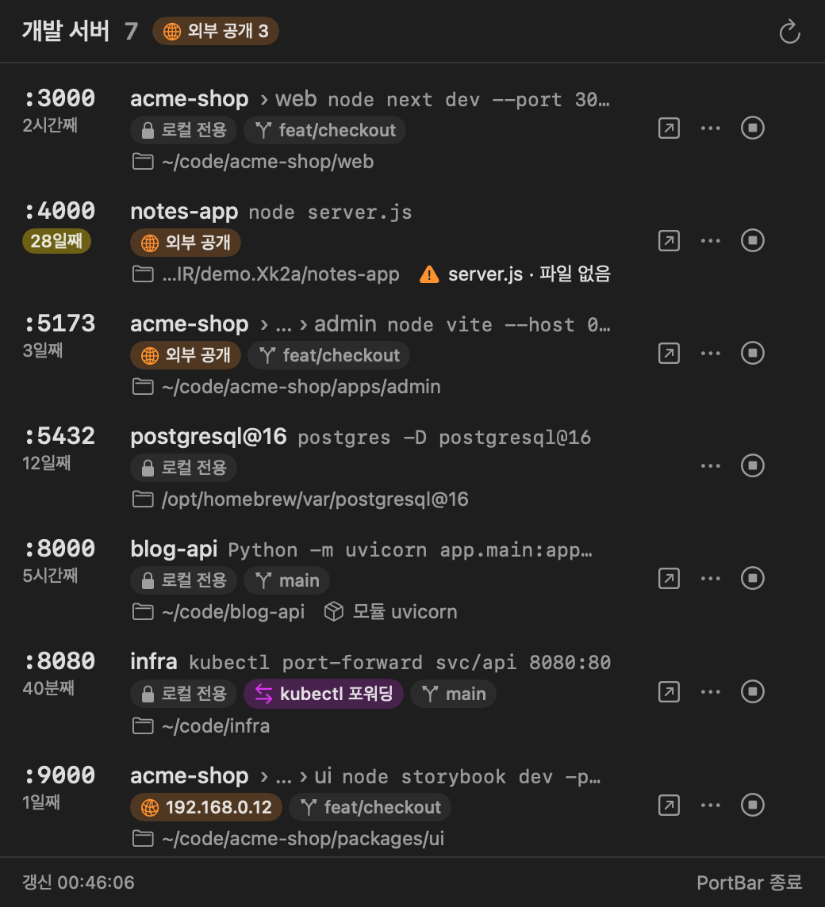
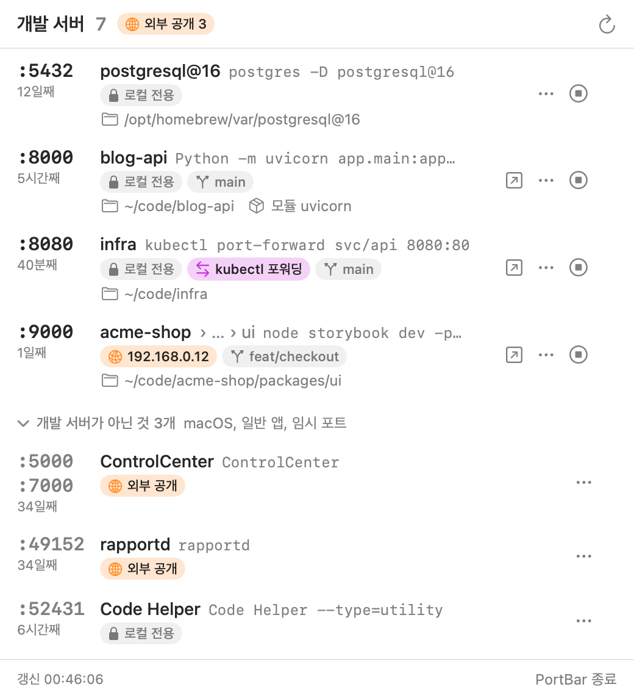

# PortBar

**지금 내 Mac에 떠 있는 개발 서버를 메뉴바에서 한눈에 보고, 열고, 끄는 macOS 앱.**

메뉴바의 서버 아이콘 옆 숫자가 실행 중인 개발 서버 수입니다. 누르면 포트마다 무엇이, 어느 폴더에서, 언제부터 돌고 있고, 누가 접속할 수 있는지 보여 줍니다.

<p align="center">
  
  
</p>

<p align="center"><sub>스크린샷은 <code>--demo</code>로 띄운 지어낸 예시 목록입니다.</sub></p>

## 이런 걸 찾아 줍니다

- **잊고 있던 서버** — 일주일 넘게 켜 둔 개발 서버는 포트 아래 날짜가 노랗게 표시됩니다.
- **모르는 사이 공개된 서버** — `*`나 `0.0.0.0`으로 열려 같은 네트워크의 다른 기기가 접속할 수 있는 서버에 "외부 공개" 배지가 붙고, 헤더에 개수가 나옵니다.
- **지워진 코드로 돌고 있는 서버** — 명령에 적힌 소스 파일이 지금 그 자리에 없으면 "파일 없음"으로 알려 줍니다.
- **포트를 차지한 프로세스** — "3000번을 누가 쓰고 있지?"를 `lsof` 없이 바로 봅니다.

## 한 행에 보이는 것

| 위치 | 내용 |
|---|---|
| 왼쪽 | 포트 번호(여러 개면 3개까지)와 켜진 지 얼마나 됐는지 |
| 첫 줄 | 프로젝트 이름과 실행 명령. 프로젝트 이름은 git 저장소 폴더 이름이고, 저장소가 아니면 작업 폴더 이름입니다 |
| 둘째 줄 | 배지: 로컬 전용 / 외부 공개 / 특정 IP, git 브랜치, 포워딩(ssh 터널, kubectl, Docker 등) |
| 셋째 줄 | 실행 위치(누르면 Finder에서 열림)와 소스 파일 또는 `python -m` 모듈 |
| 오른쪽 | 브라우저에서 열기, "…" 메뉴, 종료 |

## 할 수 있는 일

- **브라우저에서 열기** — `http://localhost:<포트>`를 엽니다. DB, 캐시, adb처럼 브라우저로 볼 것이 없는 서버에는 버튼이 없습니다.
- **"…" 메뉴** — 주소 복사, 실행 위치를 Finder에서 열기, 실행 위치·소스 파일·프로젝트 루트 경로 복사, PID 복사, `kill` 명령 복사. 행을 우클릭해도 같은 메뉴가 나옵니다.
- **종료** — 두 단계입니다. 종료 아이콘을 누르면 그 자리가 `[취소] [종료]`로 바뀌고, 3초 안에 누르지 않으면 원래대로 돌아갑니다. 종료는 `SIGTERM`을 보내고, 1.5초 뒤에도 살아 있으면 "강제 종료"(`SIGKILL`) 버튼이 나옵니다.
- **자동 갱신** — 목록은 4초마다 새로 읽습니다.

## 개발 서버와 그 밖의 것

아래 둘을 모두 만족하면 개발 서버로 셉니다.

- macOS 구성 요소(`/System/`, `/usr/libexec/`, `/usr/sbin/`, `/Library/Apple/`)나 `.app` 번들 안의 실행 파일이 아니다
- 임시 포트(49152번 이상)가 아닌 포트를 하나라도 열고 있다

나머지는 목록 아래 "개발 서버가 아닌 것" 그룹에 접혀 있습니다. 여기에는 터미널이나 브라우저 같은 일반 앱이 섞여 있어서, 실수로 끄지 않도록 종료 버튼을 두지 않았습니다.

<p align="center">
  
</p>

## 설치

아직 서명·공증된 배포용 앱은 없어서 직접 빌드해서 씁니다. macOS 15 이상과 Xcode, [XcodeGen](https://github.com/yonaskolb/XcodeGen)이 필요합니다.

```sh
brew install xcodegen
git clone https://github.com/ximhear/metal-thing01.git
cd metal-thing01
xcodegen generate
xcodebuild -scheme PortBar -configuration Release -derivedDataPath build build
open build/Build/Products/Release/PortBar.app
```

Dock 아이콘 없이 메뉴바에만 뜹니다. 끝낼 때는 팝업 아래의 "PortBar 종료"를 누르세요. 계속 쓰려면 `PortBar.app`을 응용 프로그램 폴더로 옮겨 두면 됩니다.

### 서버를 띄우지 않고 둘러보기

```sh
open -n build/Build/Products/Release/PortBar.app --args --demo
```

지어낸 예시 목록이 뜹니다. 이 모드에서는 종료 버튼이 신호를 보내지 않고 목록에서만 뺍니다.

### 글자 크기

```sh
defaults write com.example.portbar textSize 2   # 0 작게, 1 기본, 2 크게
```

PortBar를 다시 실행하면 적용됩니다.

## 무엇을 읽고, 무엇을 하지 않나

읽는 것:

- `/usr/sbin/lsof -nP -iTCP -sTCP:LISTEN`으로 대기 중인 TCP 포트
- libproc(`proc_pidpath`, `proc_pidinfo`)와 `sysctl(KERN_PROCARGS2)`로 그 프로세스의 실행 파일 경로, 작업 폴더, 시작 시각, 명령줄
- 작업 폴더에서 위로 올라가며 찾은 `.git/HEAD`(브랜치 이름). 홈 폴더 안에서만 찾습니다

하지 않는 것:

- 네트워크 요청을 하지 않고, 읽은 내용을 어디에도 보내거나 저장하지 않습니다.
- 프로세스에 신호를 보내는 것은 종료 버튼을 눌러 확인했을 때뿐입니다.

다른 프로세스의 정보를 읽어야 해서 App Sandbox는 쓰지 않습니다.

## 한계

- 내 계정으로 실행한 프로세스만 보입니다. root가 띄운 것(예: `nfsd`)은 목록에 나오지 않습니다.
- TCP로 대기 중인 포트만 봅니다.
- "외부 공개"는 대기 주소만 보고 판단합니다. 방화벽이 켜져 있으면 실제로는 막혀 있을 수 있습니다.
- 배지는 프로세스 단위입니다. 포트 여러 개 중 하나만 공개여도 "외부 공개"로 표시됩니다.
- 소스 파일은 명령줄에서 추정하므로 "파일 없음"이 틀릴 수 있습니다.
- 화면 글자는 한국어뿐이고, 로그인할 때 자동으로 열리지 않습니다.
- Apple Silicon Mac 한 대(macOS 27, Xcode 27.2)에서만 써 봤습니다.

## 실행 인자

| 인자 | 동작 |
|---|---|
| `--demo` | 이 Mac을 훑지 않고 지어낸 예시 목록을 보여 줌 |
| `--window` | 같은 목록을 일반 창으로도 띄움 |
| `--dump` | 창 없이 스캔 결과를 출력하고 끝냄 |
| `--snapshot <png>` | 화면 없이 목록을 PNG로 그리고 끝냄. `--dark`, `--others`, `--tall`, `--height <pt>`, `--demo`와 함께 쓸 수 있음 |

README의 스크린샷은 이렇게 만들었습니다.

```sh
BIN=build/Build/Products/Release/PortBar.app/Contents/MacOS/PortBar
$BIN --snapshot "$PWD/docs/images/portbar-light.png" --demo
$BIN --snapshot "$PWD/docs/images/portbar-dark.png" --demo --dark
$BIN --snapshot "$PWD/docs/images/portbar-others.png" --demo --others
```

## 저장소 구성

```
PortBar/               메뉴바 앱
  PortScanner.swift    lsof와 libproc으로 포트와 프로세스 정보를 모음
  PortModel.swift      4초마다 스캔, 열기·복사·종료 동작
  PortListView.swift   팝업 화면, 글자 크기 표(Typo)
  PortBarApp.swift     메뉴바 항목과 실행 인자
  Snapshot.swift       화면 없이 PNG로 그리기
  DemoData.swift       --demo 예시 목록
Scatter/               보류한 실험 (아래 참고)
docs/ideas, docs/plan  브레인스토밍과 기획 메모
.claude/skills/        이 프로젝트에서 쓴 Claude Code 스킬
project.yml            XcodeGen 프로젝트 정의
```

## Scatter (보류한 실험)

같은 저장소에 있는 첫 번째 실험으로, 큰 CSV를 Metal 컴퓨트 커널로 바로 산점도로 그리는 앱입니다. M2 Pro에서 천만 행(285MB) CSV를 0.2초대에 읽고 프레임당 평균 1.6ms로 그렸지만, 어디에 쓸지가 분명하지 않아 멈췄습니다. `xcodebuild -scheme Scatter -derivedDataPath build build`로 빌드할 수 있습니다.

## 앞으로

- 배포용 빌드: Release, 유니버설, 앱 아이콘, 서명과 공증
- 로그인할 때 자동 실행, 검색, 프로젝트별 묶기
- 종료 결과 알림(권한 없음, 자동 재시작으로 되살아남)
- 영어 지원
